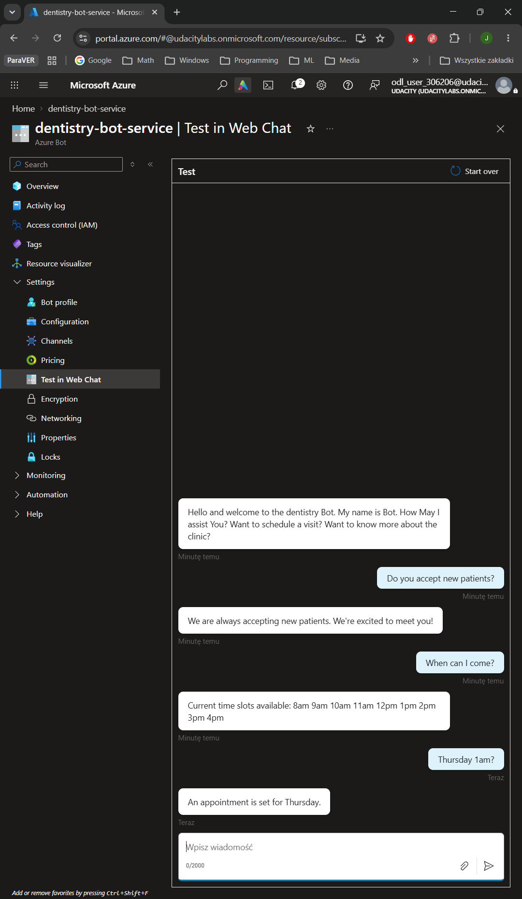
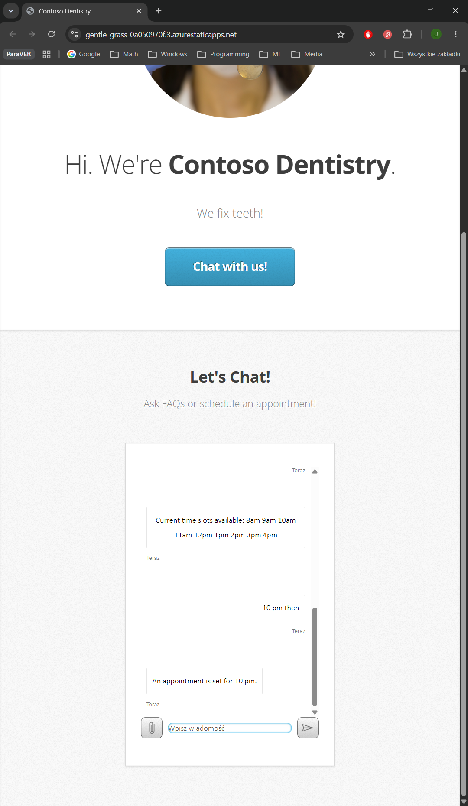
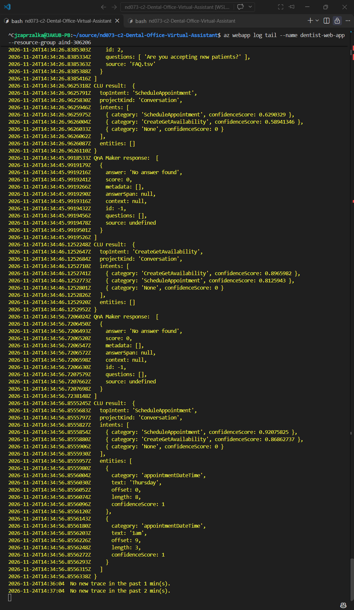

# Contoso Dentistry Virtual Assistant

This project implements a conversational virtual assistant for Contoso Dentistry. It gives users a natural-language interface for frequently asked questions and appointment-related requests. The solution combines Azure Custom Question Answering for FAQ responses, Conversational Language Understanding (CLU) for intent and date/time recognition, an appointment scheduler API, Azure Bot Service, and an Azure Static Web App with Web Chat.

## Submission summary

I followed the project in three main stages:

1. I created the bot and supporting Azure resources, because a Bot Framework application must receive activities through Azure Bot Service and expose a publicly reachable `/api/messages` endpoint.
2. I replaced the retired QnA Maker and LUIS services with their modern Language Service replacements: Custom Question Answering and CLU.
3. I deployed the conversation, scheduler, and website independently so each component could be scaled and deployed from its own folder.

The final architecture is:

```text
ContosoDentistryWebsite
        |
        | Direct Line short-lived token
        v
Azure Bot Service -> Azure App Service bot
                         |            |
                         |            +-> Custom Question Answering
                         |            +-> Conversational Language Understanding
                         |
                         +-> Dentist Scheduler App Service
```

### Why Azure Bot Service was used

Azure Bot Service was used as the channel and authentication bridge. It provides Direct Line/Web Chat channels and forwards messages to the bot's `/api/messages` endpoint. This is the same interface used by both Azure Web Chat and the public website.

### Why Custom Question Answering was used instead of QnA Maker

QnA Maker was retired on March 31, 2025. Custom Question Answering, a feature of Azure AI Language, provides the same FAQ-style knowledge-base capability and remains the supported service. The FAQ data from `starter/ContosoDentistryFAQs/FAQ.tsv` was imported into a Custom Question Answering project and deployed for bot queries.

### Why CLU was used instead of LUIS

LUIS was retired on October 1, 2025. CLU is the supported conversational language understanding service in Azure AI Language. It provides `CreateGetAvailability` and `ScheduleAppointment` intents and extracts date/time text for the scheduling flow.

The CLU project is also imported under [starter/DentistryLUIS/dentistry-luis.json](./starter/DentistryLUIS/dentistry-luis.json), with labeled and unlabeled JSON formats retained for project and import experiments.

### Why the scheduler was deployed separately

`ContosoDentistryScheduler` represents an external appointment API. It was kept separate from the bot App Service because it has a separate lifecycle, deployment workflow, and endpoint. The bot calls the scheduler's `/availability` and `/schedule` routes.

### Why Azure Static Web Apps with Azure Functions was used

Azure Static Web Apps hosts the dentist website and provides integrated hosting for static content and an API Function. This allowed the Direct Line secret to remain outside the browser and repository. The API generates a short-lived Direct Line token instead of placing a secret in `index.html`.

No iframe secret or Bot App Password is committed to the repository.

## Services

- **ContosoDentistryChatBot:** Node.js and Bot Framework bot
- **Custom Question Answering:** FAQ answers about clinic policies and patient eligibility
- **CLU:** Recognizes `CreateGetAvailability` and `ScheduleAppointment`
- **ContosoDentistryScheduler:** Express API for availability and appointment requests
- **ContosoDentistryWebsite:** Azure Static Web App with dynamic Bot Framework Web Chat

## Local Setup

1. Install Node.js 22:

```bash
nvm install 22
nvm use 22
```

2. Copy the bot environment template:

```bash
cp starter/ContosoDentistryChatBot/.env.example starter/ContosoDentistryChatBot/.env
```

3. Configure the bot, Language resource, CLU deployment, and scheduler values in `.env`.

4. Install and start the scheduler:

```bash
cd starter/ContosoDentistryScheduler
npm install
npm start
```

5. Install and start the bot:

```bash
cd ../ContosoDentistryChatBot
npm install
npm start
```

The bot listens at `http://localhost:3978/api/messages`.

## Azure Deployment

The repository includes separate GitHub Actions workflows for the bot and scheduler App Services. The Static Web App deployment is generated under `.github/workflows/` and deploys the website and `api/` token Function.

Configure Azure App Service settings through Environment variables rather than committing secrets. Configure `DIRECT_LINE_SECRET` in the Static Web App environment for the Direct Line token API.

## Testing
- FAQ and scheduling conversations were tested through the bot and the website Web Chat UI.
- `GET /availability` and `POST /schedule` were tested against the scheduler.
- Azure logs were checked for authentication, routing, and request errors ([logs file](./azure_bot_logs.png)).

### Submission evidence

- Azure Portal “Test in Web Chat”:

  

- Live Static Web App chat:

  

- Azure application and routing logs:

  

The live website is [Contoso Dentistry on Azure Static Web Apps](https://gentle-grass-0a050970f.3.azurestaticapps.net/).

The live project uses Azure Static Web Apps, Azure App Service, Azure Bot Service, Azure AI Language, and Direct Line.

## Rubric: performed and validated actions

| Criteria | What I did and verified |
|---|---|
| Train Custom Question Answering for common FAQs | I imported `starter/ContosoDentistryFAQs/FAQ.tsv` into an Azure AI Language Service Custom Question Answering project. A common question with the answer "We are always accepting new patients." is also visible in [chat](./portal_bot_test.png) and [logs](./azure_bot_logs.png). |
| Train CLU for scheduling intents | I created and deployed Language Service CLU intents for `CreateGetAvailability` and `ScheduleAppointment`. I tested availability and confirmed that CLU returned available times and routed scheduling requests to the scheduler API. |
| Provide local bot testing | I started the scheduler and bot locally under Node.js 22 and tested the chatbot before Azure deployment. My local and [Azure logs](./azure_bot_logs.png) confirmed message handling and CLU routing. |
| Deploy bot code to Azure | I deployed the bot App Service through GitHub Actions and [tested it in Azure Portal "Test in Web Chat."](./portal_bot_test.png) It displayed the welcome message, answered FAQs, and scheduled appointments. |
| Deploy the scheduler separately | I deployed the Express scheduler App Service with `/availability` and `/schedule`. I configured `SchedulerEndpoint` in the bot and normalized trailing slashes in the scheduler URL. I confirmed that bot availability and scheduling calls reached the scheduler. |
| Deploy the bot to an Azure Static Web App | I deployed the dentistry website and API Function through Azure Static Web Apps. I verified that the website loads and that `/api/directline-token` creates a temporary Direct Line token. I confirmed that live Web Chat [rendered and responded](./website_bot_test.png). |
| Provide Azure Static Web App GitHub automation | I used `.github/workflows/azure-static-web-apps-gentle-grass-0a050970f.yml`, generated for the Azure Static Web App, to deploy the website and API Function from GitHub. |
| Provide bot App Service GitHub automation | I used `.github/workflows/master_dentist-web-app.yml` to build and deploy the bot App Service from GitHub. I configured the workflow for the bot folder and verified successful deployment runs. |
| Provide scheduler App Service GitHub automation | I used `.github/workflows/master_dentist-scheduler-web-app.yml` to build and deploy the scheduler App Service from GitHub. I configured the workflow for the scheduler folder and verified successful deployment runs. |

The exact Azure Web Chat evidence is [portal_bot_test.png](./portal_bot_test.png). The exact website evidence is [website_bot_test.png](./website_bot_test.png). The logs can be found in [azure_bot_logs.png](./azure_bot_logs.png).

## Environment variables and local `.env`

The bot reads configuration from environment variables. During local development, [index.js](./starter/ContosoDentistryChatBot/index.js) loads `starter/ContosoDentistryChatBot/.env` with `dotenv`. Azure deployments read the same names from App Service Environment variables.

> **Warning:** `.env` is excluded from Git and may contain credentials. Never commit it or include real secret values in documentation or source files.

Create your local `.env` from the template:

```bash
cp starter/ContosoDentistryChatBot/.env.example starter/ContosoDentistryChatBot/.env
```

Then replace each placeholder in `.env` with the actual project values:

- `MicrosoftAppId`: the Azure Bot/Application (client) ID
- `MicrosoftAppType`: `UserAssignedMSI`
- `MicrosoftAppTenantId`: the directory tenant ID
- `ProjectName`: the Custom Question Answering project name
- `LanguageEndpointKey`: the Azure AI Language resource key
- `LanguageEndpointHostName`: the Azure AI Language resource endpoint
- `CluProjectName`: the CLU project name
- `CluDeploymentName`: the deployed CLU model name
- `CluAPIKey`: the Azure AI Language resource key
- `CluAPIHostName`: the Azure AI Language resource endpoint
- `SchedulerEndpoint`: the deployed scheduler App Service URL

`MicrosoftAppPassword` is only needed for local development with confidential-client authentication. It is intentionally commented out in the MSI-based `.env.example` and must not be set for user-assigned managed identity authentication.

## User-assigned managed identity

The Azure Bot uses user-assigned managed identity instead of a client secret for Bot Framework authentication. I created `dentistry-bot-service` as a user-assigned identity and assigned it to the bot App Service. I also assigned the identity to the relevant Azure Web App resources used in the deployment.

The same bot identity configuration was applied to the dental Web App resources because they participate in the same Azure deployment and need to share the bot identity context consistently:

- `MicrosoftAppType=UserAssignedMSI`
- `MicrosoftAppId=<dentistry-bot-service client ID>`
- `MicrosoftAppTenantId=<directory tenant ID>`
- `MicrosoftAppPassword` is omitted.

Managed identity avoids storing a Bot App Password in repository or deployment configuration. It also requires the managed identity and Azure Bot Application ID to match in the Azure portal.

## Generating Azure App Environment variables JSON

[env-to-appsettings.mjs](./scripts/env-to-appsettings.mjs) converts a local `.env` file into Azure App Service Environment variables JSON:

```bash
node scripts/env-to-appsettings.mjs \
  starter/ContosoDentistryChatBot/.env \
  appsettings.json
```

The script:

- Reads one `NAME=value` entry per non-comment line
- Ignores blank lines and comments
- Removes matching single or double quotes around values
- Writes an array containing `{ "name": "...", "value": "...", "slotSetting": false }`

This output can be imported or reviewed for an App Service, but `appsettings.json` contains the real environment values and must not be committed or shared. Azure secret values should preferably be entered directly in App Service Environment variables rather than generated as a repository artifact.

## AI Usage

The [env parsing script](#generating-azure-app-environment-variables-json) was created with the help of AI. I also used AI for some code checks. The scope of the project and deployment was created on my own.

## Built With

- Node.js 22 and the Bot Framework SDK for the bot application
- Azure Bot Service for Bot Framework channel and activity routing
- Azure AI Language Custom Question Answering instead of the retired QnA Maker
- Azure AI Language Conversational Language Understanding instead of the retired LUIS
- Azure Static Web Apps for the website
- Azure Functions under the Static Web App to generate a temporary Direct Line token

## License

[License](LICENSE.txt)
